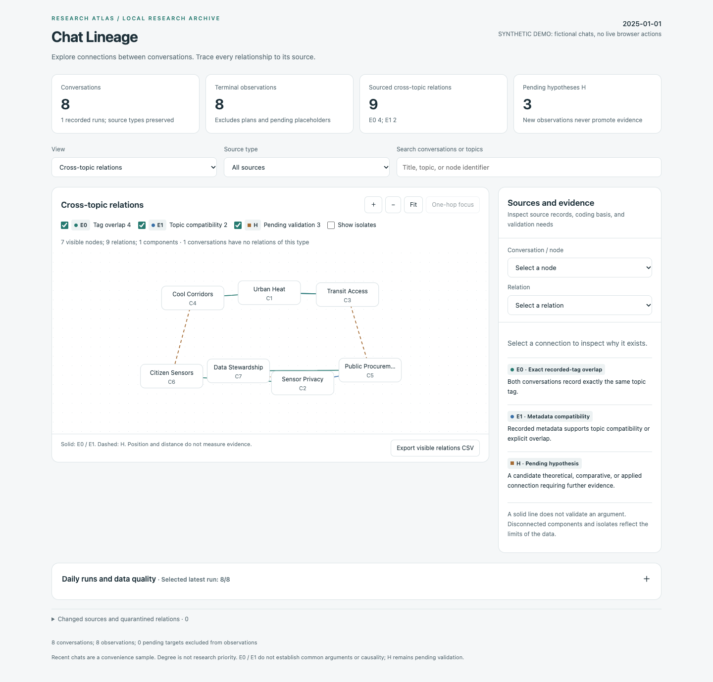
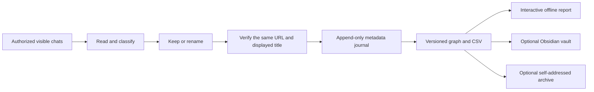

# ChatGPT Chat Lineage

**Give your chats useful names. Turn the naming trail into a sourced knowledge graph.**

ChatGPT's initial titles can be too vague to retrieve later, and a long conversation can outgrow its original name. Renaming helps you find one chat. Recording *why* it was named, which topic it belongs to, and what evidence supports that judgment helps you connect many chats.

Chat Lineage is a Codex skill with a local metadata pipeline. It inspects authorized conversations through visible Chrome UI, keeps good titles, and changes weak ones using a consistent rule:

> **Project or topic | concrete task, research question, or deliverable**

The naming pass produces small, structured observations. Those observations accumulate into a versioned graph with inspectable sources, explicit uncertainty, and optional Obsidian notes.

[Quick start](#quick-start) · [Synthetic demo](examples/demo/README.md) · [Evidence model](#a-graph-you-can-question) · [Recovery](references/RECOVERY.md) · [Privacy](SECURITY.md)



## What changes

The following examples are fictional; no real chat data is included.

| Initial title | Supported title | Why it is more useful |
|---|---|---|
| Help with research | Urban Heat \| Shade access equity research design | Names the project and concrete question |
| More analysis | Sensor Privacy \| Compare aggregation and retention policies | Identifies the work rather than a generic activity |
| Transit Access \| Accessible stop audit protocol | Same title retained | Already specific and searchable |

The vertical separator belongs inside the title. For example: `Urban Heat | Shade access equity research design`.

A strong existing title is kept **exactly**. Titles are grounded in user prompts, artifact names, headings, and necessary context; the original title alone is not enough. A recent debugging aside should not displace a long-running research project.

## From naming to knowledge



- **Bounded browser work:** one identified chat by default; explicitly authorized batches freeze ordered URLs before changes. Reordering never adds a replacement target.
- **Recovery before repetition:** a durable save intent permits one dispatch. An uncertain save triggers verification, not another click.
- **Incremental research data:** SQLite stores runs, targets, events, corrections, and save intents. Replaying the same serialized event does not insert another observation.
- **Sourced connections:** every relation points to its supporting observations, event IDs, source type, coding basis, and fingerprints.
- **A usable network:** filter evidence tiers and sources, search topics, focus one hop, inspect provenance, explore title history, and export visible edges. Disconnected topics remain disconnected.
- **Optional integrations:** one-way Obsidian synchronization protects manual notes. Gmail archival has a separate one-dispatch ledger and immutable attachments. Both require configuration and explicit user authorization.

## Quick start

### Explore without an account

Requires **Python 3.9+** and, for browser-helper tests, **Node.js 20+**. The journal and graph builder use Python's standard library. No API key is required for the offline demo.

```sh
git clone https://github.com/alexchlou/chatgpt-chat-lineage.git
cd chatgpt-chat-lineage
python3 scripts/build_demo.py --output build/demo
python3 scripts/check_release.py
python3 -B -m unittest discover -s tests -p 'test_*.py'
node --test tests/cua_workflow.test.cjs tests/recovery_integration.test.cjs
```

Open `build/demo/knowledge_graph/rename-knowledge-graph.html` in a browser. It is a standalone offline report. The generator uses only fictional, explicitly `synthetic` observations; it never opens ChatGPT or sends mail. A ready-made copy is also included at [examples/demo/index.html](examples/demo/index.html): download or clone the repository to view it locally.

### Install the Codex skill

Live renaming requires **Codex desktop with the supported `cua_repl` tool, Chrome, and an already signed-in account**. The supplied AX adapter targets macOS Chrome. It is not a standalone browser bot, Chrome extension, ChatGPT API client, or a claim of universal platform support.

```sh
python3 scripts/install_skill.py
```

The installer targets `~/.codex/skills/chatgpt-conversation-rename` and refuses to overwrite an existing installation. Use `--destination PATH` to inspect a separate installation. Restart or refresh your skill catalog as required by your host.

Start with a read-only invocation:

```text
$chatgpt-conversation-rename Inspect the current ChatGPT conversation in Chrome.
Suggest a searchable English title. Do not rename it.
```

Then explicitly authorize the intended scope:

```text
$chatgpt-conversation-rename Optimize the first 10 recent ChatGPT chats,
excluding pinned chats. Keep accurate existing titles and verify each result.
```

The English documentation and report UI include English examples. The browser adapter retains English and Chinese control labels for supported localized UIs; names may use another language when requested.

### Enable private research storage

Persistence is **off by default**. Run configuration inside the installed skill directory, choosing a private data location outside any public Git checkout:

```sh
python3 scripts/configure.py --dataset "$HOME/ChatLineageData" --timezone UTC
```

This creates an ignored `research_config.json`, initializes the local journal, and enables graph export. It refuses to overwrite existing configuration or initialize a nonempty dataset. It does not enable Gmail or Obsidian. Tell the skill that you authorize metadata storage at this location. Read [research data](references/RESEARCH_DATA.md) before using real conversations.

After a completed or interrupted run, the journal exporter refreshes CSV, JSONL, per-run JSON, the graph, and a configured Obsidian vault:

```sh
python3 scripts/research_journal.py export --root "$HOME/ChatLineageData"
```

Use [Obsidian setup](references/OBSIDIAN.md), [optional Gmail archival](references/EMAIL_ARCHIVE.md), and the [daily task template](references/DAILY_AUTOMATION.md) only when those features are wanted. This repository does not install a daemon or create a schedule. A scheduled live run still needs an available desktop session and an unambiguous signed-in Chrome profile.

## A graph you can question

| Tier | What the edge means | What it does **not** establish |
|---|---|---|
| **E0** | Two distinct chat URLs share an exactly recorded topic tag | A common argument, method, causality, or project |
| **E1** | An explicitly registered metadata overlap or compatible research issue | Validity of a theory or mechanism |
| **H** | A candidate comparison, mechanism, or application to investigate | A verified finding; always `PENDING_VALIDATION` |

E0 is computed. E1 and H require explicit registration with evidence for both endpoints. Shared task type or similar-looking titles do not automatically create semantic edges. Analyst domain coding is shown in a separate view.

New observations, successful renames, exports, and emails never promote evidence levels. When supporting observations are corrected, old relations are quarantined instead of silently rebound. Paper ideas are hypotheses with required materials and stop conditions, not claims of originality or publication readiness.

The graph can reveal useful connections between chats, but its coverage is only the chats you authorized. A recent-chat batch is a convenience sample; node degree does not measure your research priorities.

## Safety and privacy defaults

No chat bodies, excerpts, screenshots, raw accessibility trees, cookies, or tokens are retained by the research pipeline. Titles and URLs can still be sensitive. Keep datasets, reports, vaults, local configurations, and mail artifacts private; they are **not anonymized** just because bodies are omitted.

The public repository contains source code and synthetic fixtures only. A release checker rejects private configs, databases, home paths, non-example email addresses, real-looking chat UUIDs, and suspicious secret patterns. Independent Gitleaks scanning adds another layer. Neither scanner guarantees absence of all sensitive data. See [security and release scope](SECURITY.md) and [validation](docs/VALIDATION.md). The CI configuration is supplied as an inactive [workflow template](docs/ci-workflow.yml); GitHub-hosted CI has not run for this release.

## Project map

| Path | Purpose |
|---|---|
| `SKILL.md`, `PROMPT.md`, `references/` | Agent instructions, naming rules, recovery, integration contracts |
| `scripts/cua_workflow.js` | Visible-UI helper and single-dispatch save gate |
| `scripts/research_journal.py` | Append-only metadata and recovery ledger |
| `scripts/research_relations.py`, `register_research_relation.py` | Evidence tiers, registration, source quarantine |
| `scripts/knowledge_graph.py`, `assets/knowledge-graph-view.html` | Versioned graph and interactive offline view |
| `scripts/obsidian_export.py` | Conflict-aware one-way vault export |
| `scripts/email_archive.py`, `mail_report.py` | Optional immutable report and one-dispatch mail ledger |
| `tests/` | Synthetic recovery, idempotency, provenance, and privacy regression tests |

Contributions should include a minimal synthetic reproducer, not an export of private chats. See [CONTRIBUTING.md](CONTRIBUTING.md). Licensed under [MIT](LICENSE). This is an independent project, not affiliated with or endorsed by OpenAI, Google, or Obsidian.
